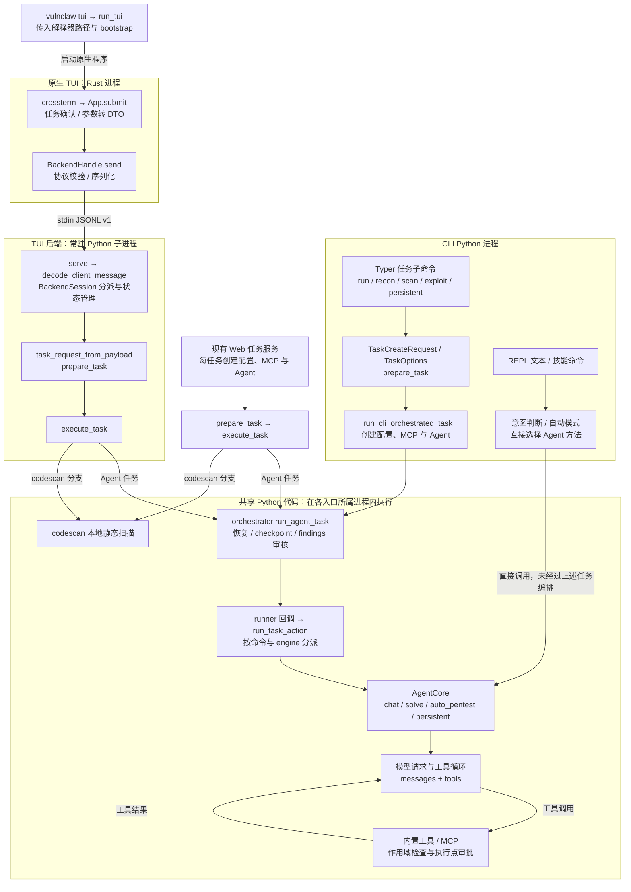
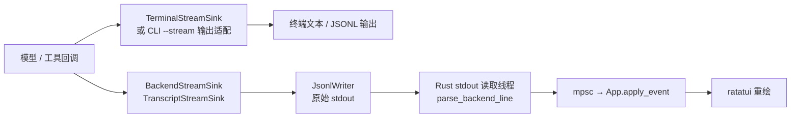
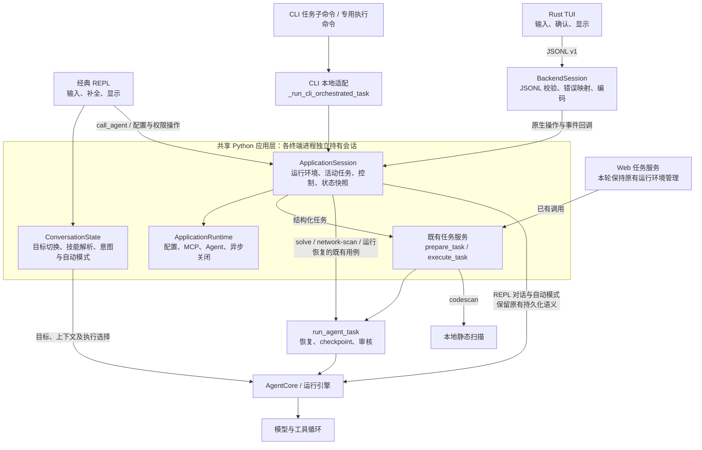
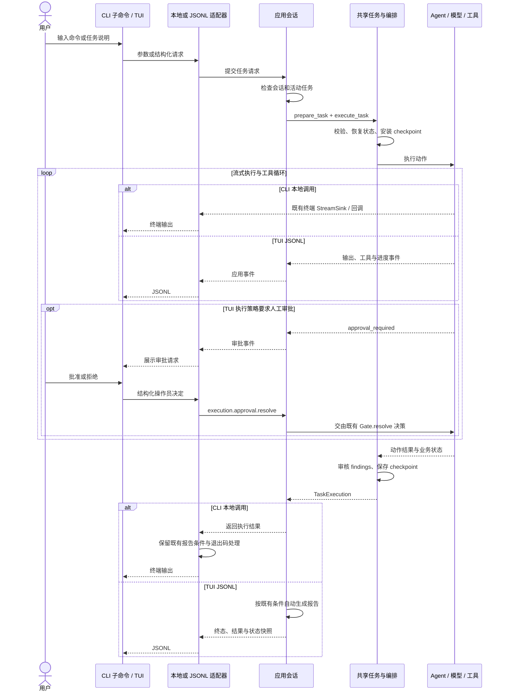
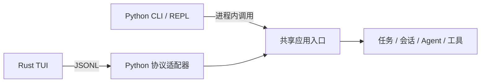
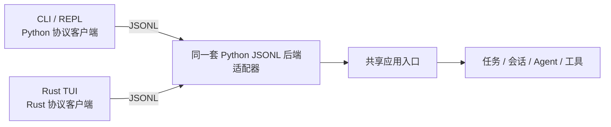

# CLI / TUI 架构演进记录

采用 **Python 模块化单体 + 统一应用层 + 轻量输入输出适配器（方案 A）**。

核心目标是让同一个业务请求经过相同的校验、会话管理、执行、审批和结果处理。CLI 可以在进程内调用应用层，Rust TUI 继续通过 JSONL 调用；两种通信方式落到同一份 Python 实现。

本文保留重构前架构，并记录本次工作区中的方案 A 实现。重构前源码快照为 `49902f55d95b3c380f3a4e1edf72a3c9be4ea942`；CLI、REPL、TUI 已迁移，Web 本轮未迁移。

当前统一输入与 TUI 自然语言实现见[当前完整架构](tui-natural-language-design.md)。下文保留重构前快照和方案 A 中间阶段的设计与取舍，不作为当前输入契约。当前实现以 `upstream/dev` 的 `9a7447621f663f302711f7d6b299c60fc80a294d` 为基线；上述历史快照来自此前工作分支。

## 重构前架构（历史源码快照）

以下描述对应上述历史快照。当时已经共享任务契约、部分执行服务、运行编排和 Agent；CLI 任务子命令、经典 REPL、原生 TUI 的输入分派与运行环境管理仍走不同路径。下面按调用关系展示现状。

图中底部表示共享代码，并非独立运行的中心服务。CLI 调用发生在自己的 Python 进程中；TUI 的 Rust 进程通过 `python -m vulnclaw.tui_backend` 启动 Python 子进程。启动和管道管理由 `exec.rs` 完成，`BackendHandle.send` 负责写请求。

主图覆盖任务子命令、REPL、原生 TUI 及已有 Web 任务入口。CLI 的独立 `solve`、`network-scan`、`code scan`、配置和报告等专用路径未逐一展开；它们不能据此视为已经全部采用同一任务入口。

### 重构前输入到执行的路径

| 入口 | 实际调用链 | 重构前运行环境归属 |
| --- | --- | --- |
| CLI 任务子命令 | Typer → `TaskCreateRequest` → `prepare_task` → `_run_cli_orchestrated_task` → `run_agent_task` → runner → `run_task_action` | CLI helper 创建并在命令结束时关闭 MCP |
| 经典 CLI REPL | 文本读取 → 内置命令 / 技能 / 意图判断 → `agent.chat/solve/auto_pentest/persistent_pentest` | `_run_repl` 创建并复用配置、MCP、Agent；有自身的结果处理与审核包装 |
| 原生 TUI | Rust 输入 → 任务确认 → DTO → JSONL → `BackendSession` → `prepare_task` → `execute_task` → `run_agent_task` → runner → `run_task_action` | `initialize` 创建 `BackendRuntime`，会话内复用；同一会话同时允许一个活动任务 |
| Web 任务 | Web 请求 → 创建后台任务和运行环境 → `prepare_task` → `execute_task` → 共享编排与动作分派 | Web 任务服务为每个任务创建并关闭 MCP / Agent 运行环境 |

`execute_task` 的 `codescan` 分支直接调用本地静态扫描，跳过 Agent 循环、状态恢复与运行编排。CLI 的 `code scan` 是独立入口，另有可选 L3 模型审查，不能与这个静态扫描分支完全等同。

后端准备出的任务包含结构化请求、任务提示和范围约束。Agent 再结合系统提示、历史消息、当前轮次和工具定义构造模型请求；界面中的原始命令文本不会整体作为协议对象直接发送给模型。

### 重构前结果回流与控制路径

- TUI 后端还会为任务生命周期与结果发送 `task_started`、`finding`、`task_completed`、`state` 等消息。普通 print / Rich 输出转到 stderr，Rust 将其作为诊断日志处理。
- `/scope`、`/config` 表单和权限操作通过 `control` 消息进入 `BackendSession` 的处理逻辑；活动任务的取消通过 `cancel_task` 处理，后端会话继续保留。
- TUI 提交任务时的本地 Y 确认，与执行 shell / python 等操作时的后端审批是两个阶段。需要人工执行审批时，后端发送 `approval_required`，界面通过 `control(operation="execution.approval.resolve")` 回传决定，由 Python Gate 处理。
- 当前原生 TUI 的 `App.submit` 只分派已实现的斜杠命令；普通文字进入 `Unknown command`。任务说明通过 `--prompt` 传入。经典 REPL 则支持直接输入自然语言。

### 重构前职责与方案 A 的对应关系

| 位置 | 重构前实现 | 本次收敛的目标 |
| --- | --- | --- |
| 运行环境 | CLI helper、REPL、TUI backend、Web task service 分别创建 | 共享创建与关闭实现，各入口按自身会话生命周期调用 |
| 执行入口 | 任务子命令经过编排；REPL 直接调用 Agent；TUI / Web 使用 `execute_task` | 明确任务、对话、控制用例，由共同应用入口分派 |
| 会话与控制 | TUI 的会话状态、control 与 JSONL 输出都在 `tui_backend.py` 中 | 提取与协议无关的应用会话，JSONL 层保留编码与传输 |
| 事件与结果 | 已有 StreamSink 基础，各入口仍包装自己的生命周期和结果处理 | 共享执行与结果投影；保留各端既有输出和报告条件 |

本节源码入口：[CLI 任务构造](https://github.com/FarStar-CN/VulnClaw/blob/49902f55d95b3c380f3a4e1edf72a3c9be4ea942/vulnclaw/cli/main.py#L1368)、[CLI helper](https://github.com/FarStar-CN/VulnClaw/blob/49902f55d95b3c380f3a4e1edf72a3c9be4ea942/vulnclaw/cli/_helpers.py#L490)、[REPL 分派](https://github.com/FarStar-CN/VulnClaw/blob/49902f55d95b3c380f3a4e1edf72a3c9be4ea942/vulnclaw/cli/main.py#L821)、[TUI 启动器](https://github.com/FarStar-CN/VulnClaw/blob/49902f55d95b3c380f3a4e1edf72a3c9be4ea942/vulnclaw/cli/tui.py#L453)、[Rust 进程与管道](https://github.com/FarStar-CN/VulnClaw/blob/49902f55d95b3c380f3a4e1edf72a3c9be4ea942/tui/src/exec.rs#L60)、[TUI 请求处理](https://github.com/FarStar-CN/VulnClaw/blob/49902f55d95b3c380f3a4e1edf72a3c9be4ea942/vulnclaw/tui_backend.py#L198)、[共享执行](https://github.com/FarStar-CN/VulnClaw/blob/49902f55d95b3c380f3a4e1edf72a3c9be4ea942/vulnclaw/task_service.py#L401)、[Web 任务服务](https://github.com/FarStar-CN/VulnClaw/blob/49902f55d95b3c380f3a4e1edf72a3c9be4ea942/vulnclaw/web/services/task_service.py#L24)。

## 1. 方案 A 实施后的终端架构

CLI 继续直接调用 Python，TUI 继续使用原有 JSONL v1；未增加 CLI 子进程、网络服务或新的协议消息。Web 仅复用已有任务服务，没有接入 `ApplicationSession`。

- `ApplicationSession` 提供本地 `open`、`run_task`、`run_orchestrated`、`call_agent`、配置/权限操作、状态快照、取消与关闭；JSONL 适配器将既有操作和事件交给同一会话处理。
- `ApplicationRuntime` 统一创建和关闭配置、MCP、Agent。CLI 一次性命令结束后关闭；REPL 的初始化、所有用户轮次与关闭使用同一个事件循环；TUI 在退出会话时关闭。
- CLI 结构化任务和 TUI 任务共同使用 `execute_task`。CLI 的输出回调通过现有 runner 接入，报告触发条件、输出路径、退出码和失败处理保留原样。
- REPL 的普通聊天与自动模式通过 `call_agent` 执行并保留原有审核行为，没有新增运行目录或恢复流程；技能、目标切换和意图状态已从 CLI 中提取。
- JSONL 的协议版本、请求/事件结构、能力声明和错误码保持原样。客户端的本地 Y 确认与后端执行审批仍是两个阶段。

当前实现入口：[应用会话](/home/FarStar/PyProject/VulnClaw/vulnclaw/application.py)、[对话状态与解析](/home/FarStar/PyProject/VulnClaw/vulnclaw/conversation.py)、[JSONL 适配器](/home/FarStar/PyProject/VulnClaw/vulnclaw/tui_backend.py)。

## 2. 应用层与界面的职责

| 职责 | 共享负责位置 | 各界面负责的部分 |
| --- | --- | --- |
| 命令、目标、选项校验 | 共享任务契约与 `prepare_task` | 把各自输入语法转换成契约 |
| 自然语言与技能调用的业务含义 | 共享对话用例 | 文本编辑、补全、命令菜单 |
| chat / solve / team / rounds 的选择 | 应用用例与现有动作分派 | 显示选择结果、提交用户选项 |
| Agent、MCP 和配置的生命周期 | 共享运行环境与应用会话 | 创建适配器、退出时关闭会话 |
| 当前目标、范围、活动任务与状态快照 | 应用会话及既有业务状态对象 | 缓存用于显示的快照 |
| 恢复、checkpoint、findings 审核 | 现有 `orchestrator.py` | 显示进度和最终结果 |
| 取消及任务终态 | 应用层 | 发出取消请求、显示终态 |
| 报告生成 | 既有报告服务；TUI 的自动报告由应用用例触发 | CLI 保留既有报告条件、路径选项和展示 |
| 执行审批与权限模式 | Python `ExecutionGate` 及控制用例 | 展示请求、收集操作员决定 |
| 流式输出 | 复用现有 StreamSink 和执行回调 | CLI 保留终端回调；TUI 由应用事件转为 JSONL；Web SSE 本轮未迁移 |

会话上下文负责引用配置、Agent、MCP、活动任务与审批上下文；业务目标、findings 等信息应从既有业务状态读取，避免再复制出一套可独立修改的权威状态。

保留当前每会话一个活动任务的限制。会话内的所有请求复用一致的上下文；一次性 CLI 命令在执行后关闭会话，REPL 和 TUI 则在退出时关闭。

输入方式、交互节奏和显示布局可以不同。例如 TUI 的提交确认弹窗、CLI 的非交互退出码、REPL 的补全菜单，都适合保留在各自适配器中。非交互模式的审批通道应明确表示无法提示用户，交由既有后端策略处理。

## 3. 应用层提供三类明确用例

| 用例 | 输入 | 执行规则 |
| --- | --- | --- |
| 任务 | 继续使用 `TaskCreateRequest` / `TaskOptions` | 有目标的 run、recon、scan、exploit、persistent、codescan；共用准备与执行入口 |
| 对话 | 文本、可选目标与 `ConversationState` | 普通问答与自动模式通过 `call_agent` 执行，保留 REPL 既有持久化和审核行为 |
| 控制 | 既有 control 操作及其参数 | 目标切换、范围、配置、权限、审批与状态查询等；通过共享处理逻辑修改状态 |

普通聊天可以没有目标，任务 DTO 当前要求目标。对话应保留独立语义，避免为了入口统一而填充虚假目标或把所有输入都转换成扫描任务。

REPL 的自然语言意图判断、自动模式续接和技能执行含义已移入共享对话逻辑。各端的原始命令语法可以保留，但等价业务请求的处理结果应一致。

现有 REPL 的斜杠命令涉及技能选择，原生 TUI 的斜杠命令涉及任务分派。迁移时要逐项确认这些语义，防止只统一命令名称便改变行为。

## 4. 结构化任务调用（CLI 子命令 / TUI）

输出继续由已有的回调 / StreamSink 机制承载。TUI 的生命周期、终态和状态事件由应用会话生产，JSONL 层负责编码；CLI 本地用例返回执行结果，继续使用现有终端回调和报告条件。两种路径共享任务执行、活动任务管理和结果投影，没有要求 CLI 改为消费 JSONL 事件。

CLI 的执行审批继续通过既有终端审批通道收集决定，TUI 使用事件与 control 回传；两者均由 Python ExecutionGate 决策。

TUI 的取消、终态和关闭由应用会话处理；本地调用通过同一会话取消并等待既有异常与清理路径，CLI 再沿用原有中断展示和退出码。状态查询和执行审批决策必须能在任务运行期间被处理；范围与配置修改沿用当前空闲期限制。

## 5. 推荐的进程与通信安排

| 入口 | 建议方式 | 原因 |
| --- | --- | --- |
| Python CLI | 直接调用应用层 | 保留简单启动和退出方式，方便脚本使用 |
| Python REPL | 持有一个应用会话，直接调用 | 自然复用 Agent、历史与 MCP |
| Rust TUI | JSONL 适配器调用应用层 | 沿用已经实现的跨语言进程边界 |
| Web | 本轮保留原有 Web 任务服务 | 沿用既有任务服务与 HTTP / SSE 接口 |

CLI、REPL 与 TUI 使用共享应用实现，结构化任务沿用相同契约。当前需求下，共享库的逻辑统一已经能解决大部分重复；所有客户端共享一个后台常驻服务会另外引入服务启动、断线、会话归属和资源隔离等问题。

如果后续明确需要 CLI 与 TUI 附着同一运行中会话、后台无人值守执行或多客户端共同观察任务，再考虑把应用会话托管到独立服务。届时这些适配器可以继续复用。

## 6. 本次文件职责调整

| 位置 | 本次调整 |
| --- | --- |
| `vulnclaw/task_service.py` | 保留任务契约、准备、执行及 codescan 分支，作为共享任务用例基础 |
| `vulnclaw/orchestrator.py` | 保留恢复、运行持久化、checkpoint 和审核职责 |
| `vulnclaw/tui_backend.py` | 抽出会话、运行环境与 control 的业务逻辑；保留 JSONL 收发和协议错误映射 |
| `vulnclaw/cli/_helpers.py` | 将运行环境创建与执行准备交给应用层；保留终端显示辅助逻辑 |
| `vulnclaw/cli/main.py` | 任务子命令和 REPL 调用应用入口；目标与自动模式状态移入共享对话模块 |
| `vulnclaw/agent/streaming.py` | 本轮未修改，复用现有 StreamSink 基础和回调 |
| `vulnclaw/web/services/task_service.py` | 本轮未修改，继续使用既有任务服务 |
| `tui/src/` | 保留输入、确认、展示和 JSONL 客户端；业务判断以 Python 响应为准 |

`application.py` 承载应用会话与运行环境，`conversation.py` 承载对话状态、技能命令解析和意图判断。移除被替代的 `cli/user_intent.py` 与 `repl_runner.py`，调用方直接使用现有模块。

不需要为了分层同时为每个既有服务增加抽象基类、接口和工厂。事件输出、审批交互等确实存在不同实现的边界，可以使用小型 Protocol 或注入回调。

多会话托管时，配置、权限模式、审批待决项与执行上下文需要有明确的归属。目前 `get_execution_gate()` 使用进程级 `_default_gate`；若进入同进程多会话设计，应显式注入所属 Gate，保证会话 A 的权限变更与审批决定不会影响会话 B 的工具执行。这是目标架构约束，本次没有验证或报告跨会话缺陷。

## 7. 迁移与验收顺序

1. **提取共享运行环境和应用会话。** 先让当前 TUI JSONL 后端委托给它，保持现有协议与持久化路径。
2. **收敛 CLI 任务子命令。** 去掉各处重复的环境创建和任务生命周期处理，让相同任务请求经过同一入口。
3. **收敛 REPL 对话与自动模式。** 保留普通对话语义，把任务路径接到共享执行；迁移时覆盖已有技能、续接和目标切换行为。
4. **提取事件与控制处理。** 复用 StreamSink，将 TUI 状态快照、终态和控制逻辑移入应用层；共享取消与审批决策，保留各端既有报告条件。
5. **Web 后续单独评估。** 本轮没有迁移 Web 的运行环境或接口。

每一步迁移后，应覆盖等价请求跨入口执行、取消后资源清理、一次性终态、审批决策和现有运行恢复。实现新增了本地调用与 JSONL 任务一致性、取消/清理、配置重绑定和 REPL 单一事件循环的行为测试；原有测试继续验证接口语义。

## 8. 当前代码依据与设计参考

- [共享任务契约与准备](/home/FarStar/PyProject/VulnClaw/vulnclaw/task_service.py:84)、[共享执行入口](/home/FarStar/PyProject/VulnClaw/vulnclaw/task_service.py:401)。
- [共享应用会话](/home/FarStar/PyProject/VulnClaw/vulnclaw/application.py:95)、[运行环境创建](/home/FarStar/PyProject/VulnClaw/vulnclaw/application.py:759)、[控制操作](/home/FarStar/PyProject/VulnClaw/vulnclaw/application.py:475)。
- [CLI 运行环境与编排适配](/home/FarStar/PyProject/VulnClaw/vulnclaw/cli/_helpers.py:490)、[REPL 的本地应用调用](/home/FarStar/PyProject/VulnClaw/vulnclaw/cli/main.py:448)。
- [Web 当前创建运行环境并调用 execute_task](/home/FarStar/PyProject/VulnClaw/vulnclaw/web/services/task_service.py:24)。
- [已有共享流式事件词汇](/home/FarStar/PyProject/VulnClaw/vulnclaw/agent/streaming.py:6)、[进程级默认 Gate](/home/FarStar/PyProject/VulnClaw/vulnclaw/agent/exec_gate.py:423)。
- [Martin Fowler：Presentation Domain Separation](https://martinfowler.com/bliki/PresentationDomainSeparation.html)：表示与业务的逻辑分离，适用于同进程和不同进程的入口。
- [Microsoft：Architectural principles](https://learn.microsoft.com/en-us/dotnet/architecture/modern-web-apps-azure/architectural-principles)：关注点分离、明确依赖和依赖倒置。本文的具体方案是结合本仓库作出的建议。

## 9. CLI 与 TUI 共用 JSONL 适配器的方案对比

可以让 CLI 和 TUI 共用同一个 Python JSONL 后端适配器。前文保留本地调用的建议优先考虑了最小改造成本；它不是技术限制。

先区分三个概念：Python 后端的协议处理实现可以完全共用；Python CLI 和 Rust TUI 仍各有客户端收发代码；各自启动同一个后端模块，也不意味着它们连接的是同一个运行中进程或会话。

### 方案 A：共享应用入口，保留两种调用方式

这里的进程内入口与 JSONL 入口应委托给同一个请求分派与应用会话。保留两种 transport，并不要求重复业务判断、状态管理或事件生产。

### 方案 B：CLI 与 TUI 共用 JSONL 后端入口

图中合并展示的是后端代码入口。默认仍然可以每个前端各启动一个后端子进程；共享运行中会话需要另外设计连接和归属机制。

### 优劣比较

| 维度 | A：本地调用 + JSONL | B：统一 JSONL |
| --- | --- | --- |
| 请求路径一致性 | 依靠共同的应用入口和契约测试；本地入口需要避免绕过共享规则 | 两端都经过协议校验和分派，一致的调用边界更直观；前端默认值仍需收敛 |
| 业务代码重复 | 应用层收敛后可消除重复 | 同样依赖应用层收敛；仅统一编码形式不能消除后端内部重复 |
| CLI 启动与资源 | 一个 Python 进程即可执行 | 按子进程方案通常多一个 Python 进程、初始化和序列化成本；具体增量需要测量 |
| 流式输出与审批 | 统一业务事件，终端与协议各自适配 | 两端消费同一协议事件，执行审批和控制调用边界一致 |
| 错误诊断 | CLI 可以直接观察 Python 调用链 | 客户端同时面对业务错误与传输错误；需要保留 stderr 诊断、请求 ID 和任务 ID |
| 崩溃处理 | CLI 与其业务执行共处一个进程 | 前端与后端进程分开，客户端可以显示后端断开；任务本身不会因此自动恢复 |
| 取消与退出 | CLI 信号和调用栈处理较直接 | 需要处理 cancel、shutdown、EOF、异常退出以及进程回收 |
| 发布变更 | CLI 与应用层随 Python 包更新 | Python 与 Rust 客户端都要满足协议契约；不兼容变更涉及版本和能力协商 |
| 自动化测试 | 应用层测试加两种入口的一致性测试 | 可将 CLI 和 TUI 对照同一协议场景验证，同时仍需要各自的输入与展示测试 |
| 一次性脚本调用 | 简单，退出码容易直接映射 | 需把任务结果映射成 CLI 退出码；后端进程成功退出不能直接代表扫描满足 fail-on 条件 |

B 的管道客户端需要持续消费 stdout 和 stderr，再等待子进程退出。管道缓冲区可能填满，直接等待退出而不读取输出会造成阻塞；这是跨进程适配器需要承担的工作。[Python subprocess 文档](https://docs.python.org/3/library/subprocess.html#subprocess.Popen.wait)

### 当前项目选择 B 时需要补齐的实际内容

1. **普通对话请求。** 现有协议的 `start_task` 面向 `TaskCreateRequest`，任务需要目标；经典 REPL 的无目标聊天应有明确的对话用例和协议表达。
2. **CLI 审批交互。** 当前 CLI 审批通道用 stdin/stdout 的 TTY 状态识别交互终端。后端接管管道后，应由前端显示 `approval_required`，通过结构化 control 回传操作员决定；非交互调用仍遵守既有权限策略。
3. **脚本输出与退出码。** 保留 CLI 的结构化输出、报告、`--fail-on` 和非交互语义。业务结果与后端进程退出状态需要分开处理。
4. **运行环境与进程关闭。** Python CLI 客户端也需要建立收发循环，使用一致的解释器与协议版本，并实现取消、断线诊断和退出回收。

`--help`、`--version`、补全等本地展示操作可以直接返回；统一后端调用重点覆盖任务、对话与业务控制。

### 针对 VulnClaw 的判断

若本次只希望低风险收敛重复代码，A 更容易落地。若目标是长期让 CLI 与 TUI 都成为同一个后端协议的客户端，B 更值得作为目标：项目已经有 JSONL 协议、状态快照、取消和审批事件，可复用的基础较多。

若明确要求所有执行客户端经过同一协议边界，B 更符合这一目标。应先把当前 `tui_backend.py` 收敛成面向所有客户端的协议入口，补齐上述 CLI 语义，再切换调用路径。应用层依然保持与 JSONL 无关，以便独立测试和供已有 Web 入口调用。这个判断不包含启动性能已经达标的承诺，也不要求增加全局后台服务。

## 10. 以整体可维护性为首要目标时的选择

针对当前仓库，建议默认采用 A：统一应用层，CLI 直接调用，TUI 通过 JSONL 委托给同一个应用入口。第 9 节中 B 的优势主要是协议边界一致；这一优势不能直接推出整体维护成本最低。

| 维护工作 | A：共享应用层，两种调用方式 | B：共享应用层，统一 JSONL |
| --- | --- | --- |
| 修改任务规则、审批策略、状态转换 | 共享应用实现修改一处 | 共享应用实现修改一处 |
| 修改事件语义 | 共享事件类型与生产逻辑修改一处；各界面处理展示 | 共享事件类型与生产逻辑修改一处；各界面处理展示 |
| CLI 通信实现 | 轻量函数调用与事件回调 | Python 客户端需要管理子进程、管道、断线及退出回收 |
| CLI 调试 | 可直接追踪应用层调用栈 | 需要关联客户端错误、协议事件与后端日志 |
| 传输异常测试 | 重点覆盖 TUI 的跨进程路径 | 还需覆盖 Python CLI 客户端的跨进程路径 |

这个选择的前提是 CLI 的本地适配器足够薄：只提交同样的请求、接收同样的事件，不自行维护另一套任务循环、状态转换、审批策略或报告流程。应用会话和事件接口应承担这些共同语义。

当协议本身成为明确的产品接口，例如需要独立发布客户端、提供其他语言客户端或稳定的黑盒集成边界时，再优先考虑 B。对于仅消除当前 CLI/TUI 行为分叉的需求，A 已经能达成目标，并减少 CLI 必须承担的通信机制。
