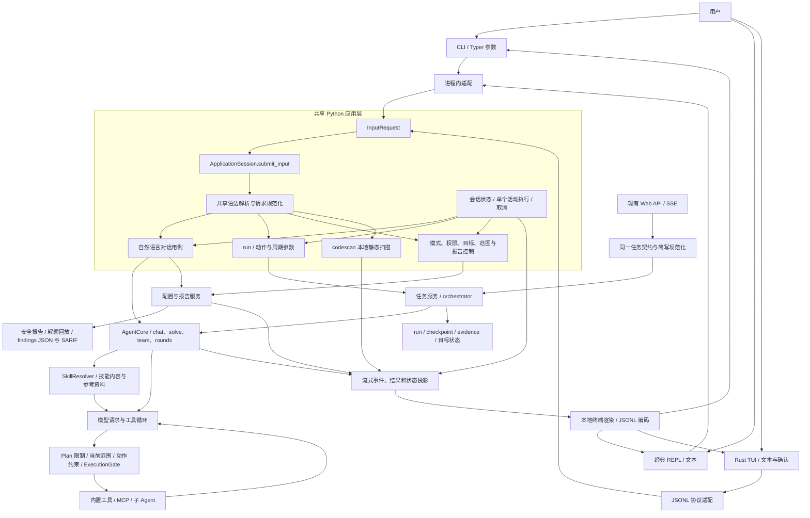
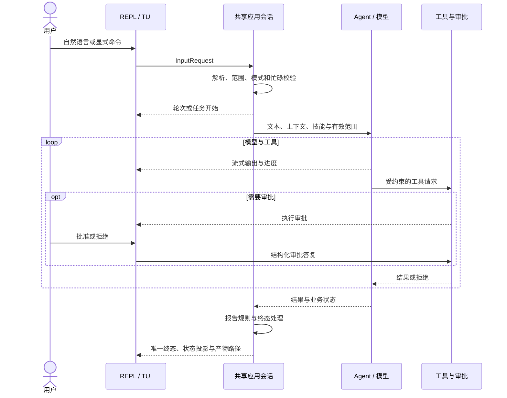

# 统一输入与 TUI 自然语言架构

状态：已实现于 `feature/tui-natural-language`，基线为 `upstream/dev` 的 `9a7447621f663f302711f7d6b299c60fc80a294d`。

采用 Python 模块化单体、共享应用会话和轻量前端适配器。CLI 通过进程内调用，Rust TUI 通过专属 Python 子进程的 JSONL 通道调用。各客户端复用代码，不共享一个运行中的 Agent。

## 1. 当前完整架构



Web 仍自行持有任务运行环境；本轮只适配共享任务契约，未接入 `ApplicationSession`。

## 2. 输入、命令与技能

`input_service.py` 定义统一命令语法。CLI 已解析的参数作为结构化请求传入，不拼接成文本重解析；REPL、TUI 普通文本进入同一个对话用例。

| 输入 | 语义 |
| --- | --- |
| 普通文本 | 自然语言，结合目标、历史和续接状态执行 |
| `/run <target>` | 具名任务，使用已有任务持久化流程 |
| `/recon` | `/run --allow-actions recon` |
| `/scan` | `/run --allow-actions recon,scan` |
| `/exploit` | `/run --allow-actions recon,scan,exploit` |
| `/persistent` | `/run --continuous` |
| `/codescan <path>` | 本地静态扫描，保留无需模型的执行路径 |
| `/clear` | 只清理显示 |
| `/new` | 重置当前对话业务状态，保留配置、权限、范围默认值和已保存文件 |
| `/mode` | Plan / Agent |
| `/permission` | ask / auto_review / full_access |
| `/target`、`/scope`、`/compact` | 目标、范围默认值、上下文压缩 |
| `/report` | 导出现有结果，可指定 `--kind security|replay` 和 `--output` |

简写只在解析层转换，没有独立执行分支。其动作集合是上限，显式参数可进一步缩小；会话范围默认值与简写取交集。动作限制传递到阶段、工具及子任务。

持续执行的主入口为 `/run <target> --continuous --rounds-per-cycle N --max-cycles N`；零周期上限表示持续执行。外层保留周期控制、停止条件和周期报告，内层复用同一引擎执行及预算参数。

技能不使用 `/skill` 或 `/<技能名>` 启动。显式选择写进 prompt：

```text
使用技能 web-pentest，分析 https://example.test 的登录流程。
/run https://example.test --prompt "Use VulnClaw skill web-pentest. Inspect login."
```

未指定时保留自动技能选择。技能不会提高权限；自发现技能的范围链接继续作为发现种子处理，不能覆盖用户显式设置的范围。

## 3. 模式、状态与生命周期

新建交互会话默认 Agent。Plan 允许解释和规划，但不向模型提供工具；后端分派也阻止模型提交的工具调用。任务启动及报告导出需要 Agent。技能加载和已有结果可供 Plan 分析。

审批策略独立：ask 对受控请求逐次审批；auto_review 按既有规则放行部分执行；full_access 免除该审批门的逐次确认。三者均不移除目标范围和动作限制。

YOLO 状态已移除；读取旧本地状态时将 YOLO 映射为 Agent，权限仍以后端为准。模式切换只在空闲时生效，运行中保留已有权限调整与审批响应。



同一会话只有一个活动执行。JSONL 收发不会等待整轮模型结束；审批、取消及允许的控制请求保持可用。忙时新执行请求明确拒绝，TUI 保留未提交文本。取消后保留已有上下文及续接要求，下一次输入可继续工作。

TUI 展示层按 `turn_*` 与 `task_*` 事件区分对话和任务。聊天期间主侧栏只保留工作区设置，不额外展示对话状态或消息摘要，顶部保持品牌和服务商信息。显式任务在侧栏展示 Task execution、阶段、发现数量和 run 记录，顶部展示 task running 或 awaiting approval 及计时。窄终端优先保留任务活动信息；`/clear` 保留状态，`/new` 清除旧回执。

普通自然语言不强制创建具名 run。显式任务继续保存 run、checkpoint、evidence 和目标状态。`/new` 不删除这些文件。

## 4. 报告语义

Agent 通过 `conversation_report` 结构化工具表达当前工作的报告类型和要求，应用层负责执行；不增加独立分类模型请求。

- 解释、规划、进展总结默认在对话中回答。
- `required` 保留完成后导出的要求；`suppress` 覆盖自动报告；`export` 立即导出现有结果而不重新测试；`default` 选择类型并使用默认设置。
- 安全测试使用 security 报告；解题与证据回放使用 replay 报告。不能仅因引擎为 solve 就选择回放。
- `session.conversation_auto_report=true` 控制一般自然语言安全测试完成后的报告；保留 `solve_auto_report`、`solve_report_show` 和 `persistent_auto_report`。
- 要求跨“继续”保留，工作完成或切换目标后结束。普通追问不重复触发已完成工作的自动报告。
- 明确导出的未完成结果标记为阶段结果。导出失败单独反馈，已完成执行保持有效。
- 正式报告沿用 dev 现有的 verified findings 过滤和报告生成器；本次未迁入其他分支的结构化发现重构。

## 5. 协议与模块边界

JSONL v1 增加 `submit_input`，payload 为文本；通过 `natural_language` 能力声明检查后端支持。增加 `turn_started`、`turn_completed`、`turn_cancelled`、`turn_failed`，复用现有工具、审批和流式事件。既有 `task_id` 用于执行事件关联，不代表一定存在具名 run。

| 模块 | 职责 |
| --- | --- |
| `input_service.py` | 命令语法、文本与结构化输入适配 |
| `application.py` | 应用会话、运行环境、执行生命周期和控制 |
| `conversation.py` | 共享对话决策、续接、范围与报告要求 |
| `task_service.py` | 任务规范化、参数、动作约束和执行 |
| `agent/execution_context.py` | 当前操作的 Plan 限制与报告接入 |
| `tui_backend.py` | JSONL 读写适配 |
| `tui/src/` | 输入、确认、布局、状态展示及协议类型 |

[重构前与方案 A 阶段的架构记录](cli-tui-unification.md)保留用于对照。消息排队、运行中追加指令、完整对话恢复及 Web 应用会话接入仍为后续范围。
